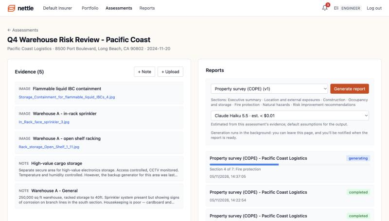
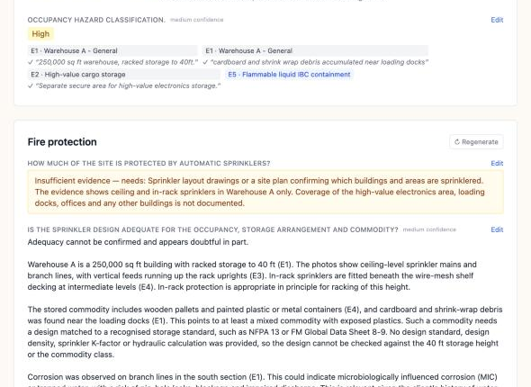
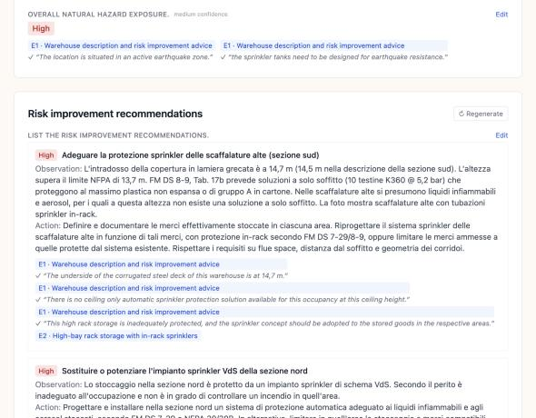
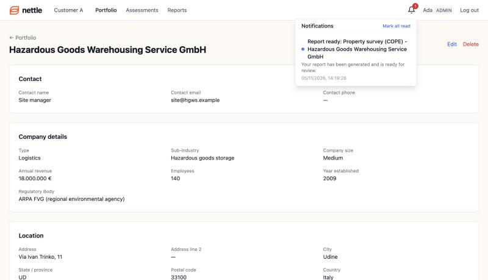

# Nettle Basic

A simplified version of the Nettle risk engineering platform: risk engineers manage
clients, run assessments, upload site evidence and generate structured, AI-written
risk reports. Multi-tenant: several Nettle customers (organizations) share one
deployment, each with its own data, users, client fields, report templates,
language, AI model and budget.

**For the take-home write-up see [SOLUTION.md](SOLUTION.md).**

## Screenshots

**Generation runs in the background.** Pick a template and a model, each with its
estimated cost for this assessment's evidence. Progress updates live, and you can
leave the page.



**Typed answers that cite the evidence.** Each answer cites the evidence it relies
on, and quotes are checked against that evidence (✓). Where the evidence can't
answer, the report says so and names what would. Sections can be regenerated and
answers edited before an engineer issues the report.



**Configured per customer.** Customer A's surveys are written in Italian. The quotes
stay verbatim from the English source PDF and are verified against it.



**Customer A's own client fields, and notifications.** "Industry" is called "Type",
"Regulatory Body" is a custom field, and amounts use the organization's currency and
locale. The bell links to the finished report.



Two real generated reports, exported as PDF: [Pacific Coast (English)](docs/samples/sample-report-pacific-coast-cope.pdf)
and [Udine (Italian)](docs/samples/sample-report-udine-cope-italian.pdf).

## Run it

```bash
cp .env.example .env
# Add your Anthropic API key to .env
# (an organization-level key also needs ANTHROPIC_WORKSPACE_ID)
docker compose up --build
```

- Frontend: http://localhost:3000
- Backend API: http://localhost:8000
- Django admin (Nettle staff): http://localhost:8000/admin/

Start-up applies migrations, syncs the configuration in `backend/tenant_config/`
(organizations, section library, templates, client fields, webhooks) and seeds demo
data. A `worker` container runs background jobs (report generation, emails,
webhooks).

### Demo accounts

Development only. Every account uses the password `nettle-demo-2026`.

| Email | Organization(s) and role |
|---|---|
| `admin@default.test` | Default Insurer: admin |
| `engineer@default.test` | Default Insurer: engineer |
| `viewer@default.test` | Default Insurer: viewer (read-only) |
| `admin@customer-a.test` | Customer A: admin |
| `admin@customer-b.test` | Customer B: admin |
| `consultant@nettle.test` | All three, with different roles: engineer in Default Insurer and Customer B, viewer in Customer A |
| `staff@nettle.test` | Django admin superuser (no tenant memberships) |

The three organizations mirror the brief:

- **Default Insurer**: standard configuration; two report templates (the original
  8-part structure and a COPE property survey).
- **Customer A**: "Industry" is called "Type", "Sub-Industry" is optional, a custom
  "Regulatory Body" field; COPE surveys written in Italian.
- **Customer B**: a corporate with no insurance fields at all, its own safety
  summary section and a deliberately small AI budget.

### A five-minute tour

1. Sign in as `consultant@nettle.test` and use the organization switcher: the
   portfolio's columns, the client form and the templates change per organization.
2. In Default Insurer, open **Q4 Warehouse Risk Review**, pick a template and a
   model (each shows its estimated cost) and **Generate report**. It runs in the
   background: close the tab if you like. The bell, a desktop notification and an
   email (printed in `docker compose logs worker`) tell you when it's ready.
3. The report shows typed answers with citations to the evidence (quotes are
   verified against it), "insufficient evidence" where the AI couldn't answer,
   and an **Evidence gaps** list of what to collect next. Regenerate any section,
   edit an answer (the AI's draft is kept), then **Approve and issue** to lock the
   report. **Export PDF** works at any point (drafts are marked DRAFT).
4. `docker compose logs backend | grep Webhook` shows the signed `report.completed`
   webhook arriving at the demo receiver, with its signature verified.

## Tests

```bash
docker compose run --rm backend pytest
```

145 tests. They cover tenant isolation on every endpoint, row-level security
directly in the database, the job queue, configuration sync, field validation, the
generation pipeline (with a fake LLM, so no API calls), cost estimates, section
regeneration, report review and PDF export. GitHub
Actions runs them on every push, validates every customer's configuration and
builds the frontend.

## Production images

`docker-compose.yaml` is for development. `docker-compose.prod.yaml` builds the
production targets (gunicorn, the Next.js standalone server, non-root users), runs
migrations as a one-off job before the app starts, and requires real secrets:

```bash
DJANGO_SECRET_KEY=... POSTGRES_PASSWORD=... APP_DB_PASSWORD=... ANTHROPIC_API_KEY=... \
  docker compose -f docker-compose.prod.yaml up --build
```

The app and the worker log in to Postgres as `nettle_app`, a role that isn't a
superuser, can't bypass row-level security and is refused tenant data outside a
tenant transaction. Nettle staff's cross-tenant Django admin runs as a separate
service on `127.0.0.1:8001` with the owner role.

## Layout

| Path | What |
|---|---|
| `backend/tenancy/` | Organizations, memberships, roles, login, per-request tenant scoping, Postgres row-level security |
| `backend/configuration/` + `backend/tenant_config/` | Configuration as code: per-organization YAML and the shared section library, validated and applied by `manage.py sync_config` |
| `backend/portfolio/` | Clients and the configurable field registry |
| `backend/reports/` | Section library, versioned templates, structured generation, background task |
| `backend/ai/` | Claude client, evidence preparation, pricing, usage ledger, budgets |
| `backend/jobs/` | Postgres job queue behind Django's Tasks API, and the worker |
| `backend/notifications/`, `backend/webhooks/` | In-app and email notifications; signed webhooks |
| `frontend/src/app/o/[org]/` | Next.js pages, all under the organization in the URL |

## Architecture

- **Backend**: Django 6 + Django REST Framework (Python 3.13)
- **Frontend**: Next.js 16 + TypeScript + Tailwind CSS
- **Database**: PostgreSQL 15 (also the job queue)
- **AI**: Anthropic Claude (`claude-opus-5-5` by default; configurable per organization)
