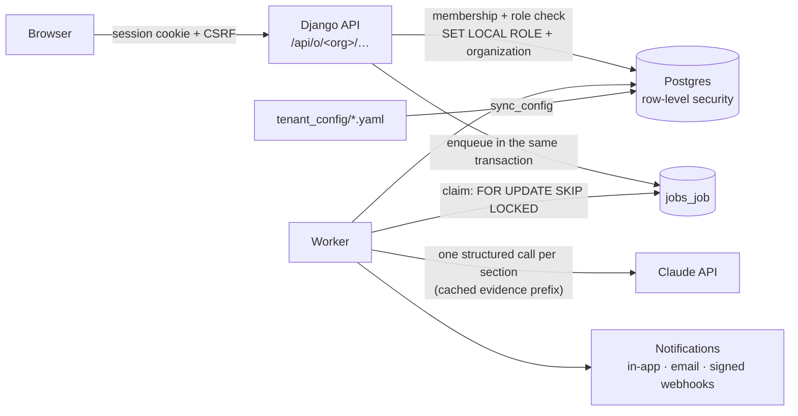

# Solution

How to run it and the demo accounts are in the [README](README.md). This document
explains what I built, why, what I deliberately left as a proposal, and what I found
(and fixed) in the prototype.

## Summary

| Challenge | Status | In one line |
|---|---|---|
| 1. Report structure | ✅ Built | A library of reusable, versioned sections; templates assembled from them per organization; the AI fills typed questions one section at a time, citing evidence with verified quotes, and says when evidence is missing; any section can be regenerated; engineers review, correct and issue the report, and export it as a PDF. |
| 2. Customisable client fields | ✅ Built | A per-organization field registry: built-in columns plus JSON custom fields, renamed / relaxed / hidden / extended from a reviewed YAML file. No model change per customer. |
| 3. Background generation | ✅ Built | A Postgres job queue behind Django 6's Tasks API; resumable section-by-section generation; in-app, desktop, email and webhook notifications. |
| 4. Multi-tenancy | ✅ Core built, 📝 regions proposed | Organizations, memberships and roles; organization in the URL; one scoped base class for every endpoint; Postgres row-level security underneath; an isolation test suite. |
| AI model and cost | ✅ Built | Engineers pick the model per report from the organization's allowed list, with a cost estimate for each; every call's tokens and cost are recorded; monthly budgets per organization. |
| Production issues | ✅ 25 fixed, 📝 12 documented | See [the review](#production-readiness-review). Includes CI and production images. |

In the code, `git grep PROPOSED` lists every extension point that is proposed but not built.

**Timebox.** Everything above was built within three hours of the first commit (the
history shows the order and the pace), and checked against the real Claude API
([numbers below](#verified-with-real-claude-runs)). The tag `timebox-end` marks the
end of the challenge work; anything after it is clearly labelled bonus material.

## Context

Nettle sells an AI workspace for loss control to insurers, brokers and
corporates. Engineers collect evidence on site, the AI drafts findings and
recommendations, and a senior engineer reviews and approves them. Today every
customer runs on a dedicated deployment, which is what challenge 4 asks to change.

**The word "client" means two things in the brief.** `portfolio.Client` is an insured
business inside a portfolio. In challenges 2-4 a "client" is Nettle's *customer*: the
tenant. I called the tenant **Organization** and left `Client` alone.

I made three decisions that run through the whole solution:

1. **Tenancy first.** Templates, field configuration, budgets and notifications are
   all per tenant; building them before tenancy would have meant touching everything
   twice.
2. **Configuration as code.** Everything that differs between customers lives in
   `backend/tenant_config/organizations/<slug>.yaml`, reviewed in pull requests,
   validated in CI (`test_repository_config_is_valid`) and applied by
   `manage.py sync_config`. The job ad says engineers own customer onboarding;
   this makes onboarding a reviewable diff instead of clicks in an admin.
3. **The database enforces what matters.** Row-level security for isolation, partial
   unique constraints against double generation and duplicate active templates,
   transactional enqueueing so a report and its job commit together.



---

## Challenge 1: Report structure and repeatability

### Approach

A report is a **template**: an ordered list of **sections**, each a set of **typed
questions**. The AI answers the questions; it no longer writes a free-text blob.

- **Section library.** A section (`fire-protection`, `construction`,
  `recommendations`…) is defined once in `tenant_config/library/sections/` and reused
  by any template. An organization can also define its own sections (customer B has a
  `safety-summary` with its internal rating scale). I seeded a COPE-based property
  library (location and exposure, construction, occupancy, fire protection),
  natural hazards, structural condition, electrical systems, housekeeping and hot
  work, recommendations and an executive summary.
- **Templates per organization** assemble sections in their own order and language.
  Default Insurer has the original 8-part structure and a COPE survey; customer A
  writes COPE surveys in Italian; customer B has a site safety review.
- **Typed questions**: text, long text, choice, rating (an ordered scale), number, and
  recommendations: a list of {title, observation, action, priority}, the same
  "Observation / Risk Improvement Action" format as the sample survey PDF.
- **Every answer** has a status (`answered` / `insufficient_evidence`), a typed value,
  a confidence, citations, and, when it can't be answered, *what evidence would
  answer it*. Those become the report's **evidence gaps**: a ready-made request list
  for the next visit or the client.

### Generation

One structured-output call per section:

- **Why per section and not one call**: per-section progress and retries (a failure
  loses one section, not the report), focused answers, and **regenerating a single
  section** when evidence changes (built: the section and the summary sections that
  summarise it are replaced; everything else, engineers' edits included, stays).
- **The cost of repeating the evidence is cached away, measured.** Every call starts
  with the same prefix (system prompt, client and assessment context, all evidence)
  with a cache breakpoint after the last evidence block. My first version gave each
  section its own output schema, and the first live run showed **zero cache reads**.
  A controlled experiment against the API showed why: the output schema is part of
  the cached prefix. Declaring every section as a strict tool instead hit the API's
  limit on compiled schema size. So every section now uses **one compact report-wide
  schema**: answers keyed by `section.question`, with typed value fields. Per-question
  rules (choice values must be one of the options, every question answered) are
  checked on the server before saving, and violations are retried. Result on the same
  assessment: **$0.52 → $0.29 per report (−45%)**, with one cache write and six cache
  reads. A test asserts that schema, system prompt and evidence are byte-identical
  across a report's calls.
- **Synthesis sections** (executive summary, overall rating) run last and are written
  from the other sections' answers.
- **The AI now sees the evidence.** The prototype sent a photo's *title* and a PDF's
  *file name*. Photos are sent as images (EXIF-rotated, downscaled to 1568 px:
  the sample photos are 24 MP and up to 7 MB, close to the API's limits and wasted
  cost since the model downscales anyway), PDFs as native document blocks, notes as
  text.
- **Citations are checked.** Evidence is labelled E1, E2…; labels are mapped back to
  evidence ids and citations of non-existent evidence are dropped. Each quote is
  verified against the evidence text (PDF text extracted with pypdf), and unverified
  quotes are flagged in the UI. The API's own citations feature can't be combined
  with structured outputs, hence the server-side check.
- **Prompt injection**: evidence is wrapped as untrusted data, can't close its own
  wrapper, and the system prompt says never to follow instructions inside it; the
  output is constrained by the schema anyway.
- **Human review.** An engineer edits any answer of a completed report. Each edit is
  validated against the question's type; the AI's draft (`ai_value`) is kept and
  shown next to the edit. Edited recommendations may keep or drop the AI's
  citations but not add new ones (a "verified" quote must come from the server's
  check). **Approve and issue** locks the report and records who issued it and when.
  The report shows how many answers engineers edited: per report a review aid, and
  across reports a measure of which questions the AI gets wrong. **Export PDF**
  renders the branded report, marked DRAFT until it is issued; two real reports
  are in [`docs/samples/`](docs/samples/).

### Repeatability and versioning

Sections and templates are **immutable versions**. `sync_config` hashes each
definition and creates a new version only when the content changes; editing a
library section creates new versions of every template using it. A report points to
the **exact template version** it was generated with, so old reports render exactly as
they did, and "which reports used the old fire-protection questions?" is a query.
Templates removed from config are retired, never deleted.

The same template always yields the same sections and questions. Wording varies from
run to run: newer models no longer accept a temperature setting, and the structure,
not the prose, is what makes reports comparable across sites.

### Trade-offs

- **JSON definitions, relational answers.** A template is a document (easy to diff,
  version and validate), while answers are rows (queryable across reports:
  "every site where sprinkler coverage is Partial").
- **Per-section calls cost more requests** than one call: ~7 calls per report. Cache
  reads make the repeated input cheap; the remaining cost is output, which is the
  same either way.
- **All evidence goes into every call.** Right for typical assessments (tens of
  items); for hundreds of photos see the two-stage proposal below.

### 📝 Proposed, not built

- **Template inheritance** ("extends: shared template, minus X, plus Y") so twenty
  customers who want something slightly different don't keep twenty drifting copies.
- **Two-stage evidence pipeline**: analyse each upload once into structured
  observations, then write sections from observations (scales to hundreds of photos,
  shows per-photo findings, cheaper per report). This mirrors Nettle's own
  "hazard detection → review → decision brief" flow.
- **Review policy and analytics**: a "four-eyes" rule per organization (the issuer
  must not be the requester), per-section review states, and a dashboard of how
  often engineers change each question's AI draft, to find weak questions.
- Natural-language template editing (proposed change → validated diff → preview),
  conditional questions, pre-filling answers from client fields, DOCX export, and
  an evaluation set built from known surveys (e.g. the Udine PDF's five recommendations).

---

## Challenge 2: Customisable client fields

### Approach

A **field registry per organization** (`ClientFieldDefinition`) describes every client
field: label, type, group, order, required, enabled, choices, help text, list
visibility, and where the value lives: **`column`** for the 24 built-in fields,
**`custom`** for a new JSONB column on `Client` (GIN-indexed).

The built-in defaults live in code; each organization's YAML lists only how it
differs. The brief's two customers are, literally:

```yaml
# customer-a.yaml
client_fields:
  overrides:
    industry: {label: Type}
    sub_industry: {required: false}
  custom:
    - {key: regulatory_body, label: Regulatory Body, type: text, group: company}

# customer-b.yaml
client_fields:
  disabled_groups: [insurance]
```

One migration, once: the built-in columns became optional in the database, so
"required" is configuration rather than schema. Customer number 21 needs a YAML file,
not a migration.

### How it behaves

- `GET /api/o/<org>/portfolio/client-fields/` returns the effective form; the
  frontend's single `ClientForm` renders it (create and edit), the detail page groups
  by it, and the list's columns are the fields marked "show in list".
- Clients are read and written as `{name, values}`. Values are validated by type
  (reusing DRF field classes) and by the organization's required fields; fields the
  organization doesn't have are rejected. Responses list `incomplete` fields: fields
  made required after older records were created, which validation shouldn't
  retroactively break.
- **Safe changes**: keys never change; removing a custom field disables it and keeps
  its data; changing a custom field's type while values exist is refused (that needs
  an explicit data migration).
- The AI prompt describes the client with the organization's own labels ("Type",
  "Regulatory Body").

### Trade-offs

- **Hybrid over the alternatives.** Entity-attribute-value tables make every query a
  pivot. Everything-in-JSON loses types: summing insured values across a portfolio
  wants a real decimal column. Typed columns for the common fields plus JSON for the
  long tail keeps both; a custom field many customers adopt can be promoted to a
  column with a normal migration.
- **YAML instead of a settings screen.** Right for engineer-led onboarding today;
  the same registry could back a self-serve admin UI later.

### 📝 Proposed, not built

A self-serve field editor for organization admins (with the same safety rules),
conditional fields, per-field permissions, and filtering and sorting on custom fields
in the list (the GIN index is there for it).

---

## Challenge 3: Background AI generation

### Approach

`POST /api/o/<org>/reports/` validates the request, creates the report as `queued`,
enqueues `generate_report_task` **in the same transaction** and returns `202`. A
worker generates the report section by section; the user can close the tab.

### The queue: Postgres, behind Django's Tasks API

Application code uses Django 6's standard Tasks API (`@task`, `.enqueue()`).
`jobs.backend.PostgresTaskBackend` stores jobs in Postgres and `manage.py run_worker`
runs them.

- **Why not Celery + Redis.** At Nettle's current size a Postgres queue is enough. It
  means one less service to run, secure, monitor and back up in every customer
  deployment. And enqueueing joins the caller's transaction, so a report and its job
  commit together: no lost jobs, no jobs for reports that rolled back. Postgres
  handles thousands of jobs a minute with `SKIP LOCKED`. The Tasks API keeps a move to
  a broker a settings change.
- Workers claim with `UPDATE … FOR UPDATE SKIP LOCKED`: run as many as you like, and
  each job goes to exactly one.
- **Leases and heartbeats**: a crashed worker's job is reclaimed when its lease
  expires.
- **Retries**: only errors that declare themselves transient (rate limits, provider
  outages, SMTP, webhook endpoints) are retried, with backoff. Bugs fail at once, with
  the traceback kept for operators.
- **Fairness**: an organization already running `JOBS_MAX_RUNNING_PER_ORG` jobs is
  skipped, so one customer's bulk run can't block everyone else.

### Robust generation

- Answers are saved after each section in a short transaction; no transaction stays
  open during an AI call, and a retry (automatic or the **Retry** button) resumes
  from the last good section instead of paying again.
- A partial unique constraint allows one queued or generating run per assessment and
  template: a double click gets `409`, not a second bill.
- Users see safe messages ("The AI declined to answer this section"), operators
  get tracebacks. The SSE endpoint is gone: it saved nothing on disconnect, left
  reports stuck at "generating" (`GeneratorExit` isn't an `Exception`), and pinned a
  web worker per generation.

### Notifications

- **In-app** (bell with unread count, per organization) and a **desktop notification**
  via the browser's Notification API while any tab is open; permission is asked when
  the user clicks "Generate report".
- **Email** through the queue, sent only if the change it announces committed
  (console backend in development: `docker compose logs worker`).
- **Signed webhooks per organization** for integrations: `report.completed`,
  `report.failed`, `budget.warning`. Endpoints are declared in YAML and secrets are
  generated into the database (never into Git). Signatures are HMAC-SHA256 over
  timestamp and body, with a replay window. URLs are SSRF-checked (https only, public
  addresses only, re-checked at delivery, no redirects). Deliveries are retried and
  logged.

### 📝 Proposed, not built

Instant pickup and live progress via Postgres `LISTEN/NOTIFY` (today: one-second
polling, and the UI polls every 3 s only while a report is active), Web Push for
closed browsers, Slack/Teams, cancellation, and Anthropic's Batch API (half price, up
to 24 h latency) for bulk regeneration across a portfolio.

---

## Challenge 4: Multi-tenancy

### Data model

- `Organization` (region, language, currency, AI model, monthly AI budget) and
  `Membership` (user ↔ organization with a role: **admin**, **engineer**,
  **viewer**). A user can belong to several organizations (brokers, consultants,
  Nettle staff).
- **Every tenant table carries its own `organization_id`**, including children such
  as evidence and answers. It's denormalised from the parent, checked on save,
  indexed with `created_at`, and protected by `PROTECT` (offboarding a tenant is a
  deliberate job, never a cascade).
- The migration is safe on a populated database: add nullable → backfill (existing
  single-tenant data becomes a "default" organization) → make required. I verified it
  on rows inserted against the original schema.

### Request path ("middleware")

The organization is in the URL, `/api/o/<org>/…` and `/o/<org>/…` in the frontend:
explicit, bookmarkable, and natural for users in several organizations.
`OrganizationRequestMixin`, the base of every tenant endpoint:

1. authenticates (session cookie + CSRF; login is rate-limited and CSRF-checked too);
2. resolves the organization from the URL and the user's **membership**, or answers
   `404` (not `403`: other tenants' existence isn't revealed);
3. checks the **role** for writes (viewers are read-only);
4. filters every query and stamps every create with the organization; related fields
   only accept the same organization's objects, so a foreign id is just "does not
   exist";
5. **scopes the database transaction to the organization** for row-level security.

I put this in a DRF base class rather than Django middleware deliberately: with
token or JWT authentication (needed for Nettle's mobile apps and Open API), DRF
authenticates inside the view, so middleware would still see an anonymous user.

### Defence in depth: Postgres row-level security

Each tenant table has a policy: rows are visible and writable only when
`organization_id` matches `app.current_organization`. Requests (and background jobs,
via `tenant_transaction()`) switch to an unprivileged `nettle_tenant` role and set
the organization with `SET LOCAL`, so both end with the transaction and can't leak
through pooled connections. No organization set means no rows. A test enumerates
every model with an organization column and fails if its table lacks a policy,
unless it's explicitly exempted with a reason (memberships, the job queue).

In production the app's login role must itself be unprivileged. The dev container
logs in as the image's superuser, which is also the deliberate bypass for migrations,
seeding and Nettle staff's Django admin.

### Proof

`tenancy/tests/test_isolation.py`: for every tenant endpoint, an admin of
organization A tries to list, read, update, replace and delete organization B's
objects, through A's URL and B's, and to attach new objects to B's parents. Every
attempt fails. `test_rls.py` checks the database layer on its own, without the API's
filters.

### Customisation per organization

Fields (challenge 2), templates and their language (challenge 1), AI model, AI budget
and webhooks: all scoped to the organization and declared in its YAML file.

### Architecture stance: pool plus silo

- **Pool.** One shared database and schema per region is the default: tenant scoping
  is a single indexed filter, migrations run once, and onboarding is a config file.
  Schema-per-tenant or database-per-tenant as the default would make migrations and
  connection pools grow with every new customer.
- **Silo.** Customers who contractually need dedicated infrastructure (what Nettle
  sells today) keep it, using the same code. A dedicated deployment is just a pool
  with one organization, so there's one codebase and two deployment shapes. A Django
  database router keyed on the organization could also place one large tenant on its
  own database inside a regional deployment.
- **Regions (📝 proposed).** One deployment per region (EU, US…), each with its own
  database, storage bucket and AI routing. The Claude API's `inference_geo` pins
  US or global only, so EU-only inference goes through an EU cloud region. A small
  global directory sends each user's login to their organization's region.
- **Moving today's deployments in (📝 proposed).** Each per-customer database becomes
  one organization in the regional database. The prototype's UUID primary keys mean
  no id collisions. Export, stamp `organization_id`, import, copy files under the new
  prefix, and verify counts per table.

### 📝 Proposed, not built

SSO (SAML/OIDC per organization, just-in-time memberships), token authentication for
the mobile apps and Open API, composite foreign keys so the database guarantees
child-parent organization equality, organization-scoped Django admin with an audit
trail, per-tenant API rate limits, and per-tenant encryption keys.

---

## Production-readiness review

### Fixed

| # | Problem in the prototype | Fix |
|---|---|---|
| 1 | No authentication or authorization: every endpoint `AllowAny`; anyone could read or delete everything and trigger paid AI calls | Session login, memberships and roles, `IsAuthenticated` by default (`1d21dec`, `fa1f009`) |
| 2 | Evidence files public at guessable `/media/evidence/YYYY/MM/<original name>`; only served with `DEBUG=True` anyway | Organization-checked download endpoint with `nosniff` and `CSP: sandbox` (`1c2da15`) |
| 3 | Hardcoded `SECRET_KEY`, `DEBUG=True`, `ALLOWED_HOSTS=*`, CORS open to all; `DATABASE_URL` set in compose but ignored | Environment settings, fail fast in production (`e53f493`) |
| 4 | `makemigrations` ran at container start (unreviewed schema changes, written into the source tree via the bind mount) | Committed migrations; a test fails on drift (`0187cd1`) |
| 5 | Postgres published on all interfaces with default credentials | Bound to localhost (`0187cd1`) |
| 6 | Seed not atomic (a failed seed never re-ran), would run in any environment | Atomic and development-only (`0abc80e`) |
| 7 | `fields="__all__"`: callers could set a report's status/content, or move evidence and reports between assessments | Explicit, read-only fields (`98d97c6`) |
| 8 | Uploads: no size or type limit, client-declared type, HTML/SVG served from the API origin (stored XSS), personal data in file names | Content-sniffed allowlist, size cap, server-derived type, random names, immutable evidence (`9722315`) |
| 9 | Malformed UUID in `?assessment=` → 500 | 400 (`61790df`) |
| 10 | The AI never saw photos or PDFs (title and file name only) | Images and native PDF documents (`cd32ce5`) |
| 11 | Evidence concatenated straight into the prompt (prompt injection) | System prompt, untrusted wrapping that can't be escaped, schema-constrained output (`cd32ce5`, `036cabb`) |
| 12 | `max_tokens=4096` with `stop_reason` ignored: truncated reports saved as completed | Per-section structured output; refusals and truncation handled (`5fae0c8`) |
| 13 | Closing the tab lost the report and left it "generating" forever (`GeneratorExit` isn't an `Exception`); SSE pinned a web worker per generation (and dies at gunicorn's 30 s default) | Background jobs with checkpoints, leases and failure finalisation (`7568a8e`) |
| 14 | A double click started two paid generations | Partial unique constraint → 409 (`7568a8e`) |
| 15 | Raw exception text sent to the browser | Safe messages for users, tracebacks for operators (`7568a8e`) |
| 16 | Hardcoded model; no record of cost | Model per deployment and organization; usage ledger; cost per report; monthly budgets (`5fae0c8`, `da79d81`) |
| 17 | API key defaulted to a fake placeholder (failed at runtime) | Empty by default, clear error (`e53f493`, `5fae0c8`) |
| 18 | "Add Client" linked to a page that didn't exist; clients couldn't be edited | Schema-driven create/edit (`8630494`) |
| 19 | Any failed fetch left pages on "Loading…" forever; failed reports were hidden | Error states everywhere; all report statuses shown (`5e13505`, `38a2594`) |
| 20 | SSE client broke multi-byte characters and dropped events split across chunks | SSE removed; progress by polling (`38a2594`) |
| 21 | UK clients' money shown in `$`; a value of 0 shown as "—"; report Markdown shown raw | Organization currency, correct empty check, structured rendering (`8630494`, `38a2594`) |
| 22 | No tests and no CI | 145 tests, including tenant isolation and RLS; GitHub Actions runs them, validates every customer's config and builds the frontend (throughout, `a0a1d99`) |
| 23 | Containers ran the dev servers (`runserver`, `next dev`) as root, with `npm install` and a compiler in the image | Multi-stage images: gunicorn + WhiteNoise and the Next.js standalone server, non-root, `npm ci`; `docker-compose.prod.yaml` runs migrations as a one-off job before the app (`05c7ee5`) |
| 24 | No human checkpoint between the AI's draft and the client | Engineers edit answers (AI draft kept), then approve and issue a locked report (`5e816f7`, `a29c145`) |
| 25 | *Found in my own work by the first live run:* prompt caching never hit (the per-section output schema is part of the cached prefix) | One report-wide schema with server-side per-question checks: −45% cost per report, measured (`c48f83c`) |

### Documented, not fixed

| # | Problem | What production needs |
|---|---|---|
| 1 | No pagination on list endpoints | DRF pagination (cursor-based for large portfolios) and server-side filtering |
| 2 | Deleting a client cascades to assessments, evidence and reports (an underwriting audit trail), and orphans files on disk | Soft delete and archival; evidence cited by issued reports protected; retention policy per organization; file cleanup job |
| 3 | No audit log beyond report review (who edited and issued) | Who changed what and when across models and admin, immutable |
| 4 | Files on local disk; no malware scanning (Nettle's security page promises it) | Object storage with signed URLs; ClamAV (or a provider) in the upload path |
| 5 | No observability | Structured logs with request and organization ids, error tracking, metrics for queue depth and age, AI latency and spend |
| 6 | Evidence (possibly personal data) goes to an AI provider | Data processing agreement, zero data retention, per-organization opt-in, regional inference |
| 7 | Django admin is cross-tenant (superuser, by design) | Organization-scoped admin or an internal tool, with an audit trail |
| 8 | The dev database login role is a superuser | Unprivileged login role in production (required for RLS to bind) |
| 9 | Login throttling uses per-process memory | Shared cache (Redis or database) |
| 10 | Default Django `User` model | A custom user model, ideally from day one (switching later is painful) |
| 11 | `NEXT_PUBLIC_API_URL` is baked in at build time | Same-origin API behind one domain, or runtime configuration |
| 12 | `TemplateSection` rows (ids only) aren't RLS-protected | Add an `organization_id` for uniformity |

---

## Verified with real Claude runs

Generated through the app with Claude Opus 5.5 (effort `medium`):

| Run | Sections | Time | Cost | Cache | Answers |
|---|---|---|---|---|---|
| Pacific Coast, COPE survey (3 photos, 2 notes), first version | 7 | 130 s | $0.52 | 0 tokens read; every section rewrote ~9.5k | 12 answered, 10 "insufficient evidence"; 31 quotes, all verified |
| Same, after the caching fix | 7 | 117 s | $0.29 | one write of 9,437, then 6 × 9,437 read | 22 answers |
| Customer A: Udine survey PDF (4 pages) + 3 photos, COPE survey **in Italian** | 7 | 192 s | $0.57 | one write of 19,088, then 6 × 19,088 read | 20 answered, 2 "insufficient evidence"; 69 quotes, all verified against the PDF text; 9 recommendations |

What the output shows:

- **The model reads the photos.** It noted that the photo titled "Flammable liquid IBC
  containment" shows the containment unit *with no IBC visibly in place*.
- **It says what it doesn't know.** Construction and natural hazards were marked
  "insufficient evidence", each with a specific request: FEMA flood zone, proximity
  to the Newport–Inglewood fault, NFPA 72 test certificates, a water-flow test
  against the 40 ft rack design.
- **The estimate holds up.** The model picker estimated $0.27 for a run that cost
  $0.29, with output calibrated on the organization's 14 previous sections.

## What I'd do next

1. An evaluation set from real surveys, run in CI on every prompt or template change
   (the Udine PDF's five numbered recommendations are a natural first case).
2. From the original plan, not built yet: cancelling a running generation,
   pagination and filters, evidence thumbnails and deletion (refused while an issued
   report cites the item), iPhone HEIC photos, report export to DOCX, and a
   development inbox (Mailpit) for notification emails.
3. Soft delete with retention, and an audit log: the next production gaps for real
   customer data.
4. LISTEN/NOTIFY for instant job pickup and live progress.
5. The two-stage evidence pipeline for large assessments.
6. Regions and the migration path from per-customer deployments.

## How I used AI

I used Claude Code throughout, as Nettle expects. I first had it review the brief,
the codebase and Nettle's public site, then **discussed the plan before any code**:
an essential version of all four challenges, with alternatives for each design
decision that I chose between (organization in the URL, row-level security,
configuration as code, the section library, a Postgres queue behind the Tasks API,
fairness, webhooks, budgets). It then implemented commit by commit, with a test in
each commit. I reviewed the changes as they landed, and the history is the real
order of work, including the bugs we found along the way (the isolation suite caught
a broken route; the first live run showed prompt caching wasn't hitting, which we
then proved with a controlled experiment and fixed, measuring the saving). Commits
carry a `Co-Authored-By` trailer.
